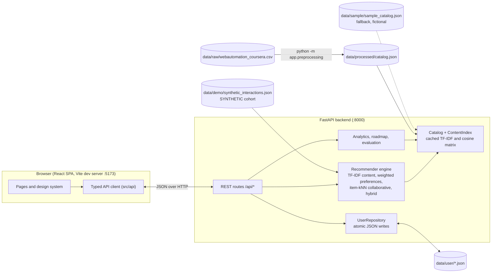

# CourseCompass AI

An explainable course recommendation and learning-analytics platform built for a Recommender Systems mini-project.
It ranks 184 cleaned Coursera listings against a student's career goal, skills, difficulty, time and budget
preferences, shows the exact components behind every match score, tracks study progress locally, and reports
offline evaluation metrics honestly.

- **Frontend:** React 19, Vite 7, TypeScript, Tailwind CSS 3, Framer Motion, Recharts, Lucide, React Router
- **Backend:** Python, FastAPI, Pydantic, Pandas, NumPy, SciPy, scikit-learn, Uvicorn
- **Storage:** local JSON files written atomically by the backend (no database server, no accounts, no API keys)

---

## 1. Quick start on Windows 11

### Requirements

| Tool | Version | Notes |
|---|---|---|
| Python | **3.12, 3.13 or 3.14** (64-bit) | Tick "Add python.exe to PATH". 3.13 recommended. |
| Node.js | **22 LTS or newer** (20.19+ works) | Includes npm. |
| Internet | first setup only | Downloads Python and npm packages (about 100 MB + 150 MB). |

No administrator rights, Docker, database or API keys are needed.

### Steps

1. Extract `CourseCompass_AI_Complete.zip` and open the `CourseCompass_AI` folder in VS Code.
2. Double-click **`setup.bat`** (or run `.\setup.bat` in the VS Code terminal). It checks Python and Node,
   creates `backend\.venv`, installs pinned packages, validates the course data, prepares the synthetic demo
   cohort and evaluation report, and installs frontend packages from `package-lock.json`.
3. Double-click **`run.bat`**. It starts the backend and frontend in two new windows, waits until both answer,
   and opens the app.

| What | URL |
|---|---|
| Web app | http://127.0.0.1:5173 |
| API health | http://127.0.0.1:8000/api/health |
| Interactive API docs (OpenAPI) | http://127.0.0.1:8000/docs |

**To stop:** close the windows titled "CourseCompass API" and "CourseCompass Web" (or press Ctrl+C in each).
`run.bat` will not start a second copy if a server is already answering on its port.

4. Optional: **`test.bat`** runs all backend tests, frontend tests, the TypeScript type check and the production build.

### Equivalent manual commands (VS Code PowerShell terminal)

```powershell
# one-time setup
cd backend
py -3.13 -m venv .venv
.\.venv\Scripts\python.exe -m pip install -r requirements.txt
.\.venv\Scripts\python.exe -m app.setup_check
cd ..\frontend
npm ci

# run (two terminals)
cd backend;  .\.venv\Scripts\python.exe -m uvicorn app.main:create_app --factory --host 127.0.0.1 --port 8000
cd frontend; npm run dev

# tests
cd backend;  .\.venv\Scripts\python.exe -m pytest -q
cd frontend; npm test; npm run build
```

Data commands (backend folder, venv active): `python -m app.preprocessing` (rebuild the catalog from the CSV),
`python -m app.synthetic` (regenerate the synthetic cohort), `python -m app.evaluation` (recompute metrics).

---

## 2. Problem statement and objectives

Students choosing online courses face hundreds of similar listings and opaque "recommended for you" lists.
CourseCompass AI aims to:

1. recommend courses that fit a stated career goal, existing skills and practical constraints (level, time, budget, language);
2. explain every recommendation with the actual numbers that produced it, including why a course ranked lower;
3. help students act on recommendations: wishlist, enrolment, progress, study time, goals, a skills roadmap;
4. evaluate the algorithms reproducibly with Precision@K, Recall@K and NDCG@K, and be honest about what the data can show.

---

## 3. Features

| Page | What it does |
|---|---|
| **Landing** | Live "match map" from the real recommender for six sample career goals, the default weights loaded from the backend config, data provenance. |
| **Profile / onboarding** | Three-step form: career goal, objectives (free text), skill level, existing skills, topics, preferred difficulty, weekly hours, free-only budget, preferred length, languages. Editable and resettable. |
| **For You** | Ranked recommendations with a match dial, plain-language reason, goal skills, new skills, cautions, a full score breakdown, similar courses, save, enrol, relevant / not relevant feedback, compare, "Why isn't a course higher?", hybrid vs content-only switch. |
| **Discover** | Search by title, description, topic and skill; filters for content type, level, length, category, language, skill, free-only and minimum rating; sort by search relevance, match score, rating, length or title; pagination; URL-synced filters. |
| **Course detail** | Description, provider, artwork (remote image with local fallback), level, length, price status, rating (review count not in data), certificate, detected skills (new vs known), syllabus modules, validated Coursera link, personal match with breakdown, feedback and 1-5 rating, similar courses. |
| **Compare** | Two or three courses side by side: match, reason, score makeup, every component, provider, type, level, length, price, rating, language, unique and shared skills, TF-IDF similarity matrix. Add, remove and replace. |
| **My Learning** | Status tabs (not started, in progress, paused, completed), lesson steppers, editable lesson totals and target dates, study-session logging with history, pause / resume / complete / reopen / remove. |
| **Analytics** | Totals, weekly goal, 12-week study hours with goal line, 14-day minutes, lessons completed over time, skill exposure radar, courses by status, monthly hours, streaks, milestones, target-date tracking, recent activity. Every chart has a data-table view. |
| **Roadmap** | Four ordered stages per career goal with skills (known / to learn), suggested courses, completed / current / upcoming status, dependencies, next-course suggestion, persisted milestones. |
| **Wishlist** | Saved courses with save dates. |
| **Insights & settings** | Method explanation with live weights, evaluation tables and chart with re-run, dataset provenance and preprocessing report, remote-image toggle, demo seeding and removal, reset-all with backup, troubleshooting. |

Cross-cutting: keyboard focus styles, skip link, reduced-motion support (`MotionConfig reducedMotion="user"` plus CSS),
responsive layouts down to phone width, skeleton loaders, empty and error states with retry, toasts.

---

## 4. Architecture



### Project structure

```
CourseCompass_AI/
  setup.bat  run.bat  test.bat        Windows entry points
  scripts/start-backend.bat, start-frontend.bat
  backend/
    requirements.txt  pytest.ini
    config/recommender.json           editable weights (see section 6)
    app/
      main.py                         FastAPI app factory, CORS, error handlers
      config.py  jsonio.py  schemas.py
      preprocessing.py                CSV -> cleaned catalog (+ report)
      catalog.py  search.py  taxonomy.py
      recommender/content.py          TF-IDF + cosine + Rocchio feedback
      recommender/preference.py       weighted preference scoring
      recommender/collaborative.py    item-kNN collaborative filtering
      recommender/engine.py           hybrid engine, explanations, similar courses
      interactions.py  synthetic.py   interaction schema, synthetic cohort generator
      evaluation.py                   Precision/Recall/NDCG@K, hold-out protocol
      analytics.py  roadmap.py  demo.py  storage.py  services.py  setup_check.py
      routes/                         courses, recommendations, profile, library, learning, insights
    data/raw/  processed/  sample/  demo/  user/
    tests/                            65 pytest tests
  frontend/
    package.json  package-lock.json  vite.config.ts  tailwind.config.js  .env.example
    src/api/  components/  components/ui/  hooks/  lib/  pages/  test/
```

---

## 5. Dataset, provenance and preprocessing

**Source.** `webautomation_coursera.csv`: 242 rows x 16 columns scraped from public Coursera catalog pages
(timestamps 29-30 July 2022): url, title, provider, type, image, category, certificate, description, duration,
language, level, prerequisites, price, rating, syllabus, timestamp.

**Licensing.** The CSV carries no documented redistribution licence. Course titles, descriptions, ratings and links
belong to Coursera and its partners. The project uses the data for private academic demonstration only. The raw CSV
is therefore **not included in the ZIP** and is git-ignored; the cleaned catalog needed to run the app is bundled.
Check the licensing before publishing this project publicly. To rebuild from the CSV, copy it to
`backend/data/raw/webautomation_coursera.csv` and run `python -m app.preprocessing`.

**Pipeline** (`backend/app/preprocessing.py`, reproducible, original CSV never modified; report written to
`data/processed/preprocessing_report.json`):

1. Read every column as text; normalise column names (`associated-university-institution-company` -> `provider`, etc.). Missing columns are treated as optional.
2. Convert placeholders (`-`, empty, `n/a`, ...) to missing values; strip zero-width characters and extra spaces.
3. Validate and canonicalise URLs (https, lower-case host, no query, fragment or trailing slash).
4. Exclude non-course rows: a category listing page (`/browse/...`) and two records with no title or metadata.
5. De-duplicate by canonical URL. 54 rows were exact duplicates (only the scrape timestamp differed). Repeated titles with different URLs would be kept and flagged (none occur).
6. Keep content types distinct: course 112, specialization 41, professional certificate 16, guided project 15.
7. Parse level (missing for 44), duration into hours or months plus a bucket (short < 10 h, medium 10-40 h, long > 40 h or <= 3 months, extended > 3 months), price status (`free` 164, `not_listed` 5 where the page showed only "Enroll", unknown 15), rating (0-5), certificate, languages.
8. Parse the `~.~`-separated syllabus into module titles and clean text (noise such as "SHOW ALL SYLLABUS" removed).
9. Replace the generic partner-grid image with "no image" so a designed local fallback is used.
10. Detect skills from each course's own title, category, description and syllabus using transparent keyword patterns (`taxonomy.py`); 179 of 184 courses get at least one skill. Skills are labelled "detected", never invented.

**Result: 242 rows -> 184 unique courses.** Prerequisites and review counts are empty for every record in the source,
so the app never shows or infers them; explanations say prerequisite gaps cannot be checked.

**Fallback.** If neither `catalog.json` nor the CSV can be read, the app loads `data/sample/sample_catalog.json`:
12 clearly labelled fictional "[Sample]" records with no links or ratings, so the application still works.

---

## 6. Recommendation algorithms

All algorithm code lives in `backend/app/recommender/` and is documented in-line.

### 6.1 Content-based filtering (TF-IDF + cosine similarity)

Each course becomes one document: title (counted twice), category, detected skill labels, description, syllabus.
`TfidfVectorizer(stop_words="english", ngram_range=(1, 2), sublinear_tf=True, strip_accents="unicode", max_df=0.85)`
builds L2-normalised vectors, so a dot product is a cosine similarity. The course vectors and the full 184 x 184
similarity matrix are computed once at start-up and cached.

The **student profile vector** is built from the career goal label and description, the goal's skills the student does
not have yet, chosen topics and free-text objectives. Feedback adjusts it with **Rocchio relevance feedback**:

```
profile = 1.0 x query + 0.6 x mean(saved / enrolled / relevant / well-rated courses) - 0.4 x mean(not-relevant courses)
```

### 6.2 Weighted preference score

```
preference = sum_k (w_k x s_k) / sum_k w_k      over components k that have data (s_k in [0, 1])
```

| Component | Default w | How s_k is computed |
|---|---|---|
| content | 0.30 | profile-course cosine divided by the best cosine in the catalog for this profile |
| goal | 0.25 | mean of: career-skill coverage (matched goal skills / min(3, goal skills)) and topic match (1/0) |
| skill_fit | 0.10 | share of the course's goal-relevant skills the student does not know yet |
| difficulty | 0.12 | 1.0 same level, 0.5 one level apart, 0.1 two apart |
| duration | 0.10 | 1.0 same bucket, 0.6 / 0.25 / 0.0 for 1 / 2 / 3 buckets apart |
| budget | 0.08 | only when "free only": free 1.0, price not listed 0.35, paid 0.0 |
| quality | 0.05 | dataset rating mapped 3.5..5.0 -> 0..1 |

- **Missing metadata is never a negative match:** a component without data (level not listed, "any" difficulty, no
  budget limit) is removed from both sums.
- **Correlated signals:** `content` uses free text while `goal` and `skill_fit` use the structured taxonomy; their weights
  are kept moderate so the same evidence is not counted twice at full strength.
- Weights are configurable in `backend/config/recommender.json` (restart the backend after editing).

### 6.3 Collaborative filtering (item-kNN)

**Interaction schema** (`interactions.py`): save +1, enrol +2, complete +3 (on top of enrol), relevant +2,
previously studied +2, not relevant -2, rating (stars - 3) x 1. A course's strength is the sum, clipped to [-3, 5].

```
sim(i, j) = cosine(R[:, i], R[:, j]) x n_ij / (n_ij + 5)     (significance shrinkage; top 20 neighbours kept)
cf(i)     = sum over the student's positive courses j of sim(i, j) x log1p(strength_j)
```

R is the user x course matrix of log-scaled positive strengths. Courses with fewer than 2 interacting users have no
reliable evidence and return "no signal" (neutral) rather than zero.

**Data honesty.** The CSV has no learner history. Collaborative filtering is trained on
`data/demo/synthetic_interactions.json`: 150 simulated learners and 1,229 interactions, generated with a fixed seed
from career-skill coverage, category, a provider ("program") affinity, level, rating and random noise
(`synthetic.py`). Every record is flagged `synthetic: true`, and the UI labels it "synthetic demo cohort". It is not
real student behaviour and is never used to claim real-world effectiveness.

### 6.4 Hybrid score, modes and fallback

```
final = (1 - lam) x preference + lam x cf_normalised
lam   = 0.30 x min(1, interacted courses / 5)          (0 for a course with no cohort evidence)
```

- **Content mode:** `final = preference`.
- **Hybrid mode:** collaborative filtering switches on once the student has positive interactions with **at least 2
  different courses**; otherwise the API returns `method_used = "content_fallback"` with the reason.
- Every result returns the method used, each component's score, weight, contribution and contribution to the final
  score (they sum to the displayed score), plus the explanation generated from those numbers.
- Completed, "previously studied" and "not relevant" courses are excluded; enrolled courses are excluded from For You;
  courses known to be in non-preferred languages are excluded (unknown language is kept).
- The percentage shown is a **preference-match score**, not a probability of success and not model accuracy.

### 6.5 Cold start

- **New student:** onboarding answers alone produce a content + preference ranking (no history needed).
- **No preferences at all:** results fall back to rating order and the UI hides the match dial and asks for onboarding.
- **New course:** it has TF-IDF features immediately; collaborative evidence is "none" so it is neither boosted nor penalised.

### 6.6 Explanations

Generated from the actual scoring result: summary from the two largest positive contributions, per-component
reasons with impact, matched goal skills, new vs known skills, shared TF-IDF terms, cautions (level above the
student's, price not confirmed free, long duration at current weekly hours, missing level or language), a prerequisite
note, and for any course a comparison against the number-one course listing the largest component gaps
(`GET /api/recommendations/explain/{id}`).

### 6.7 Similar courses and roadmap

- Similar: `0.85 x TF-IDF cosine + 0.10 x same category + 0.05 x level match`, x0.8 if languages differ.
- Roadmap stage courses: `0.40 x stage-skill coverage + 0.35 x match score + 0.15 x level fit for the stage + 0.10 x
  career-category match`, picked greedily so suggestions span the stage's skills. A stage completes when its milestone
  is ticked or a suggested course is completed. The roadmap is guidance, not a guarantee of employment or competency.

### 6.8 Feedback loop (what really happens)

Saves, enrolments, completions, ratings and relevant / not-relevant feedback are stored immediately. On the **next
request** they change the Rocchio profile vector, exclusions, known skills (from completed or previously studied
courses) and the collaborative signal. No model is re-trained per click; the TF-IDF index and the item-kNN model are
built at start-up.

---

## 7. Evaluation

`backend/app/evaluation.py`, run with `python -m app.evaluation` or from Insights > Evaluation.

- **Ground truth:** a synthetic learner's held-out positive interactions; relevance is binary.
- **Split:** per learner, a seeded (seed 7) random 25% of positive courses (at least 1) is held out. Learners with
  fewer than 4 positives are excluded (0 here). Collaborative filtering is re-trained on training interactions only and
  each learner's training courses are removed from their candidates, so there is no leakage.
- **Metrics:** Precision@K = hits in top K / K (K used even if fewer candidates); Recall@K = hits / held-out items;
  NDCG@K with binary gains and an ideal ranking of min(K, |relevant|) hits. K = 5 and 10. Macro-average over learners
  with standard deviation and a 95% normal interval. Ties broken by course id.

**Actual results** (150 synthetic learners, 301 held-out items, generated by this code):

| Method | P@5 | R@5 | NDCG@5 | P@10 | R@10 | NDCG@10 |
|---|---|---|---|---|---|---|
| Popularity baseline | 0.045 | 0.121 | 0.089 | 0.039 | 0.200 | 0.120 |
| Content, profile only (cold start) | 0.171 | 0.436 | 0.355 | 0.107 | 0.534 | 0.395 |
| Content + feedback | 0.175 | 0.444 | 0.371 | 0.111 | 0.561 | 0.417 |
| Collaborative only (item-kNN) | 0.145 | 0.357 | 0.301 | 0.100 | 0.493 | 0.354 |
| Hybrid | 0.163 | 0.401 | 0.347 | 0.112 | 0.560 | 0.408 |

Hybrid minus content on NDCG@10: -0.009 (hybrid better for 48 learners, content better for 43, tied 59): no meaningful
difference on this data. All personalised methods clearly beat popularity.

**Limitations:** the cohort is synthetic and was generated from the same skill taxonomy the content scorer uses, which
favours content-based methods; 150 learners and 184 courses is a small sample; offline ranking metrics do not measure
learning outcomes, satisfaction or employment. The numbers demonstrate a correct, leakage-free pipeline, not real-world
quality.

---

## 8. Storage and data integrity

- `backend/app/storage.py` (`UserRepository`) is the only code that touches `backend/data/user/`: profile, wishlist,
  feedback, enrolments (progress, lesson totals, target dates), study sessions, goals, roadmap milestones, activity log.
- Writes are atomic (temp file in the same folder, `fsync`, `os.replace`, with retries for Windows file locks) behind a
  re-entrant lock.
- Unreadable or wrongly shaped files are moved aside as `*.corrupt-<timestamp>.json` (never silently deleted) and
  replaced with defaults; Settings shows which files were recovered.
- "Reset all local data" requires typing RESET and first copies everything to `data/user/backups/`.
- Validation: lesson counts 1-500 and never above the total, study minutes 1-1440, no future session dates (one day of
  tolerance for time zones), target dates not in the past, weekly goal 0.5-80 h, course ids must exist, unknown career
  goals / topics / skills / languages rejected.
- Demo activity ("Seed demo activity") is flagged `demo: true`, labelled in the UI and removable without touching real
  records; editing a demo enrolment turns it into a real one.
- Replacing JSON with a database means implementing the same `UserRepository` methods; routes, frontend and algorithms
  do not change.

---

## 9. API overview

Full schema: http://127.0.0.1:8000/docs. All errors return `{"error": {"code", "message"}}` without tracebacks or paths.

| Method and path | Purpose |
|---|---|
| GET `/api/health`, `/api/system/info` | Health; provenance, preprocessing report, recommender config |
| GET `/api/meta/taxonomy` | Career goals, skills, categories, languages, filter vocabularies |
| GET `/api/courses` | Search, filter, sort, paginate (`q, category, content_type, level, duration, language, skill, free_only, min_rating, sort, page, page_size`) |
| GET `/api/courses/{id}`, `/api/courses/{id}/similar` | Detail with personal score; similar courses |
| POST `/api/courses/compare` | 2-3 courses side by side |
| GET `/api/recommendations` | `mode=hybrid|content, limit, offset, include_enrolled` |
| GET `/api/recommendations/explain/{id}` | Rank and gaps versus the number-one course |
| GET `/api/recommendations/preview` | Landing preview for a career goal (does not change the profile) |
| GET/PUT `/api/profile`, POST `/api/profile/reset` | Preferences |
| GET/POST `/api/wishlist`, DELETE `/api/wishlist/{id}` | Wishlist |
| GET/POST `/api/feedback`, DELETE `/api/feedback/{id}` | Relevant / not relevant / previously studied / rating |
| GET/POST `/api/learning`, PATCH/DELETE `/api/learning/{id}` | Enrolments, lessons, status, target date |
| POST `/api/learning/{id}/sessions`, GET `/api/sessions`, DELETE `/api/sessions/{id}` | Study sessions |
| GET/PUT `/api/goals` | Weekly goal |
| GET `/api/analytics` | All analytics, computed from saved data |
| GET `/api/roadmap`, PATCH `/api/roadmap/{career}/milestones/{stage}` | Roadmap and milestones |
| GET `/api/evaluation`, POST `/api/evaluation/run` | Offline evaluation |
| POST `/api/system/demo/seed`, `/api/system/demo/clear`, `/api/system/reset` | Demo data and reset (confirmation required) |

Configuration: `frontend/.env` holds `VITE_API_BASE_URL` (example in `.env.example`). Backend environment variables
(optional): `COURSECOMPASS_API_PORT` (used by run.bat), `COURSECOMPASS_CORS_ORIGINS`, `COURSECOMPASS_USER_DATA_DIR`.

---

## 10. What was implemented, tested and not verified

| Area | Status |
|---|---|
| Backend tests | **65 pytest tests passed** (Linux, Python 3.13): preprocessing and validation, catalog fallback, TF-IDF properties, Rocchio, preference formula and missing-data rule, budget/difficulty/duration, item-kNN with sufficient and insufficient interactions, cold start, hybrid formula and explanation sums, exclusions, language filter, determinism, metrics by hand, hold-out leakage, evaluation reproducibility, atomic writes, corrupt-file recovery, reset backup, demo removal, analytics and streaks, roadmap, invalid requests, CORS, full API journey with restart. |
| Frontend tests | **16 Vitest tests passed**: search and filters, empty and error states with retry, recommendation rendering, wishlist save, relevance feedback refresh, lesson progress, score breakdown, API client encoding and errors, formatting. |
| Type check and build | `tsc -b` and `vite build` succeeded. |
| Browser end-to-end | Scripted in headless Chromium against the running servers: landing preview, onboarding, recommendations and breakdown, save and feedback, hybrid switch-on, enrolment, search/filter/sort, compare, study session, lesson update, weekly goal, roadmap milestone, **backend restart and persistence check** - passed. Desktop and mobile screenshots reviewed. |
| Python packages on Windows | Verified that every pinned package has a prebuilt **win_amd64** wheel for Python 3.12, 3.13 and 3.14 (`pip download --platform win_amd64`). |
| **Not verified** | `setup.bat`, `run.bat` and `test.bat` were **not executed on Windows** (built and tested on Linux). Remote Coursera image URLs could not be reached from the build environment; local fallback artwork was verified instead. Verify on Windows with `setup.bat`, then `test.bat`, then `run.bat`. |

---

## 11. Limitations and future improvements

- Collaborative filtering and evaluation rely on a synthetic cohort; collecting real (consented) interaction data is the most valuable next step.
- Skills are detected with keyword patterns; an embedding model or curated skill tags would improve precision.
- Month-based durations cannot be converted to hours without guessing hours per week, so they use buckets.
- No prerequisite data exists in the source; prerequisite reasoning is therefore disabled rather than invented.
- Single local profile without authentication by design; multi-user support would need real auth and a database.
- Future: A/B-style online evaluation, diversity and novelty metrics, learning-to-rank on real feedback, calendar-aware study plans.

---

## 12. Viva explanations (beginner-friendly)

- **TF-IDF.** Turns text into numbers. A word gets a high weight in a course if it appears often in that course (term
  frequency) but rarely across all courses (inverse document frequency). "SQL" in an SQL course scores high; "course" scores low everywhere.
- **Cosine similarity.** Treats two TF-IDF vectors as arrows and measures the angle between them. 1 = same direction
  (very similar text), 0 = nothing in common. Length of the text does not matter.
- **Content-based filtering.** Recommends items similar to what the user wants or liked, using item features (here course text). Works for new users and new items, but can be narrow.
- **Collaborative filtering.** Uses behaviour instead of content: "people who engaged with A also engaged with B".
  Item-based kNN finds courses whose interaction patterns resemble the ones you liked. Needs interaction data.
- **Hybrid recommendation.** Combines both so each covers the other's weakness. Here a confidence-weighted blend:
  collaborative weight grows with the number of courses you interacted with, capped at 30%.
- **Cold start.** The problem of recommending with no history (new user) or no interactions (new item). Solved here by
  onboarding preferences plus content features, with collaborative filtering only after enough interactions.
- **Precision@K.** Of the top K recommendations, what fraction were relevant? (quality of the shortlist)
- **Recall@K.** Of all relevant items, what fraction appeared in the top K? (coverage)
- **NDCG@K.** Like recall but rewards putting relevant items higher; divides by the best possible ordering so 1.0 is perfect.

---

## 13. Ten-minute presentation plan and demo script

| Time | Segment | What to show / say |
|---|---|---|
| 0:00-1:00 | Problem | Too many similar courses; black-box recommendations. Goal: personal, explainable, actionable. |
| 1:00-2:00 | Data | Insights > Dataset: 242 rows -> 184 courses, duplicates and placeholders handled, nothing invented, licensing caveat. |
| 2:00-3:30 | Product demo 1 | Landing match map (switch career chips). Profile: pick Data Analyst, add Excel as a known skill, free only, medium length, save. |
| 3:30-5:00 | Recommendation logic | For You: open "Score breakdown" on #1 - each component's score x weight = points; unscored components excluded. Show a caution. Use "Why isn't a course higher?" on an astronomy course. |
| 5:00-6:15 | Hybrid and cold start | Point at "content + preferences (collaborative unavailable)". Save one course and enrol in another -> status turns Hybrid with a 12% collaborative weight. Toggle "Content only" to compare. Mention the synthetic cohort honestly. |
| 6:15-7:45 | Learning analytics | Discover search "SQL" with free filter; compare two courses. My Learning: log 45 minutes and 1 lesson. Analytics: totals, weekly goal, charts (table view). Roadmap: tick a milestone. Optionally seed demo data (labelled). |
| 7:45-9:00 | Evaluation | Insights > Evaluation: protocol, metrics table, NDCG chart; personalised >> popularity; hybrid ~ content on synthetic data and why. |
| 9:00-10:00 | Limitations and close | Synthetic interactions, keyword skills, no prerequisites in data, offline metrics vs real outcomes; next steps. |

Before presenting: run `run.bat`, optionally Insights > Settings > Seed demo activity, and afterwards Remove demo data.

---

## 14. Sample viva questions

1. **Why TF-IDF and not raw word counts?** Raw counts favour long descriptions and common words; TF-IDF down-weights words that appear everywhere and sublinear TF dampens repetition.
2. **What exactly is the percentage on a card?** A preference-match score: the weighted average of available components (and in hybrid mode a blend with the collaborative signal). It is not a probability of success or an accuracy.
3. **How do you avoid penalising courses with missing metadata?** Unavailable components are removed from numerator and denominator; the UI lists them as "not scored".
4. **Where does collaborative data come from?** A seeded synthetic cohort, because the CSV has no interactions. It is labelled everywhere and not used to claim real-world performance.
5. **When does hybrid mode actually use collaborative filtering?** After positive interactions with at least 2 different courses; the weight is 0.30 x min(1, n/5). Before that it falls back to content and says so.
6. **How did you prevent data leakage in evaluation?** Per-user hold-out, CF re-trained on training interactions only, training items removed from candidates, fixed seeds.
7. **Why is hybrid not better than content in your results?** The synthetic learners were generated from the same skill taxonomy the content scorer uses, so content already captures most of the signal; the paired difference is within noise. Real data could differ.
8. **What does NDCG add over recall?** Position sensitivity: a relevant course at rank 1 counts more than at rank 10.
9. **How is cold start handled for a new course?** TF-IDF features exist immediately; collaborative evidence is "none", so the course is neither boosted nor penalised by CF.
10. **How is user data kept safe from corruption?** Atomic writes, corrupt-file quarantine, confirmation and backups before reset.
11. **Can the roadmap guarantee a job?** No. It is a suggested sequence of skills and catalog courses; the app states this.
12. **How would you scale this?** Swap `UserRepository` for a database, precompute item-item similarities offline, add an embedding model, and collect real feedback for learning-to-rank.

---

## 15. Troubleshooting

| Problem | Fix |
|---|---|
| setup.bat: Python not found | Install Python 3.13 (64-bit) with "Add python.exe to PATH"; open a new terminal. The Microsoft Store "python" alias does not count. |
| setup.bat: Node.js too old | Install Node.js 22 LTS or newer. |
| pip install fails | Check internet/proxy; run setup.bat again (it resumes). Python 3.15+ may lack prebuilt wheels - use 3.13. |
| `npm ci` fails | setup.bat retries with `npm install` automatically. Delete `frontend\node_modules` and rerun if needed. |
| App says it can't reach the backend | Keep the "CourseCompass API" window open; open http://127.0.0.1:8000/api/health. |
| Port 8000 busy | `set COURSECOMPASS_API_PORT=8010` then `run.bat` (the frontend is pointed at the new port automatically). |
| Port 5173 busy | Close the other program using it (Vite is set to a strict port), then run.bat. |
| Blank course images | Remote 2022 image links may be gone or you are offline; local artwork is used. Toggle in Insights > Settings. |
| Analytics empty | Log a study session in My Learning, or seed demo activity in Insights > Settings. |
| Start fresh | Insights > Settings > Reset all local data (backup kept in `backend\data\user\backups`). |
| Changed the CSV | Put it in `backend\data\raw\`, run `python -m app.preprocessing`, `python -m app.synthetic`, `python -m app.evaluation`, restart run.bat. |
